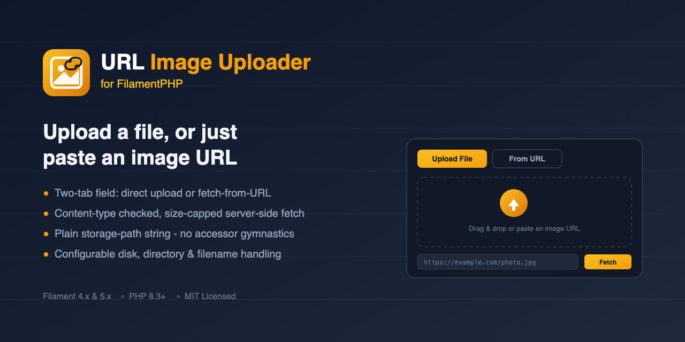

<p align="center">
  
</p>

# Filament URL Image Uploader

A Filament form field with two tabs: upload an image file, or paste an image URL and fetch it
server-side. Either way your model gets a plain storage path string.

[](https://packagist.org/packages/amjadiqbal/filament-url-image-uploader)
[](https://packagist.org/packages/amjadiqbal/filament-url-image-uploader)
[](https://filamentphp.com/plugins/amjadiqbal-url-image-uploader?utm_source=github&utm_medium=readme&utm_campaign=filament-url-image-uploader)
[](LICENSE)

## Supported versions

| Package | Filament | Laravel | PHP |
|---|---|---|---|
| **2.x** | 4.x and 5.x | whatever your Filament version supports (11.28+, 12.x, 13.x) | 8.3+ |
| 1.x ([`1.x` branch](https://github.com/amjadiqbal/filament-url-image-uploader/tree/1.x)) | 3.x | whatever Filament 3 supports | 8.3+ |

## Installation

```bash
composer require amjadiqbal/filament-url-image-uploader
```

Composer picks the right major for your Filament version. Fetched and uploaded files are stored on
the `public` disk by default, so make sure it is linked:

```bash
php artisan storage:link
```

No panel plugin registration or asset build is needed: the field works in any Filament form.

## Usage

```php
use AmjadIqbal\FilamentUrlImageUploader\Components\UrlImageUploader;

UrlImageUploader::make('image')->directory('images');
```

The field renders two tabs: upload a file directly, or paste an image URL and click **Fetch Image**
to download it server-side. Either way, the value saved to your model attribute is always a plain
storage path string (e.g. `"images/example.jpg"`), never an array, so no accessor or mutator is
needed on your model:

```php
// database column: image (string, nullable)

class Post extends Model
{
    protected $fillable = ['image'];
}
```

To render the stored image elsewhere in your app, resolve it through the disk you configured:

```php
Storage::disk('public')->url($post->image);
```

### What the URL fetch checks

- Only `http://` and `https://` URLs are fetched (`file://`, `php://`, `data:` and similar are refused).
- The download is capped (10 MB by default) and has a 10 second timeout.
- The downloaded bytes must be an image (checked by content, not by file extension).
- Fetched files get a random filename prefix, so two URLs with the same basename never overwrite each other.

Each failure shows a Filament notification and stores nothing. A malformed URL left in the URL tab
also blocks saving with a field error.

## Configuration

### Directory
```php
UrlImageUploader::make('image')->directory('custom/path/here');
```

### Disk
By default, files are stored on the `public` disk. You can target any configured disk:
```php
UrlImageUploader::make('image')->disk('s3');
```

### Preserve original filenames
```php
UrlImageUploader::make('image')->preserveFilenames();
```
With this on, a fetched file keeps its original name, and gets a `-1`, `-2`, ... suffix instead of
overwriting a file that already exists.

### URL fetch size limit
```php
UrlImageUploader::make('image')->maxUrlFetchSize(5 * 1024 * 1024); // 5 MB
```

## Scope

`UrlImageUploader` manages a single image per field. It does not support Filament's `multiple()`
mode. For a gallery of several images, use a `Repeater` of them.

### Using it in a Repeater (image gallery)

```php
use Filament\Forms\Components\Repeater;

Repeater::make('gallery')
    ->schema([
        UrlImageUploader::make('image')->directory('gallery'),
    ])
    ->reorderable()
    ->addable()
    ->deletable();
```

Each row gets its own instance of the field, so adding, deleting and reordering rows keeps every
image with its own row. This is covered by a dedicated test suite
(`tests/Feature/RepeaterGalleryTest.php`).

**Gotcha:** while a row is being edited, its live state is the field's internal `{path, url}`
shape, not the flat string your model attribute ends up with. If you add an `itemLabel()` that reads
the row's image value, read `$state['image']['path'] ?? null` (an array), or don't key the label off
this field at all.

## Upgrading from 1.x (Filament 3)

Upgrade Filament itself first (see Filament's
[upgrade guide](https://filamentphp.com/docs/4.x/upgrade-guide?utm_source=github&utm_medium=readme&utm_campaign=filament-url-image-uploader)),
then:

```bash
composer require amjadiqbal/filament-url-image-uploader:^2.0
```

The field's PHP API (`make()`, `directory()`, `disk()`, `preserveFilenames()`, `maxUrlFetchSize()`)
and the stored value are unchanged, so your forms and data need no changes. Published translations
still apply.

## Translations

All user-facing strings ship in English by default. Publish them to customize or translate:

```bash
php artisan vendor:publish --tag="filament-url-image-uploader-translations"
```

## Testing

```bash
composer test         # PHPUnit, via Orchestra Testbench
composer analyse      # Larastan/PHPStan (level 5)
composer format       # Laravel Pint
scripts/ci-local.sh   # all of the above on PHP 8.3 and 8.4, against Filament 5 and Filament 4
```

## Changelog

Please see [CHANGELOG.md](CHANGELOG.md) for what changed in each release.

## Security Vulnerabilities

Please report security issues privately through
[GitHub's private vulnerability reporting](https://github.com/amjadiqbal/filament-url-image-uploader/security/advisories/new).
See [SECURITY.md](SECURITY.md).

## Contributing

Contributions are welcome. See [CONTRIBUTING.md](CONTRIBUTING.md) (CI for this repo runs locally).

<a href="https://github.com/amjadiqbal/filament-url-image-uploader/graphs/contributors">
  
</a>

### Custom Development
[Hire me on Upwork](https://www.upwork.com/freelancers/amjadkhatri?utm_source=github&utm_medium=readme&utm_campaign=filament-url-image-uploader) for:
- Package integration
- Custom feature development
- Technical consultation
- Project implementation

### Community Support
- [Discord](https://discord.com/users/412244229520359434)
- [Filament plugin page](https://filamentphp.com/plugins/amjadiqbal-url-image-uploader?utm_source=github&utm_medium=readme&utm_campaign=filament-url-image-uploader)
- [GitHub Issues](https://github.com/amjadiqbal/filament-url-image-uploader/issues)

For priority support and enterprise solutions, please reach out via [Upwork](https://www.upwork.com/freelancers/amjadkhatri?utm_source=github&utm_medium=readme&utm_campaign=filament-url-image-uploader) for direct assistance.

## License

MIT. See [LICENSE](LICENSE).
